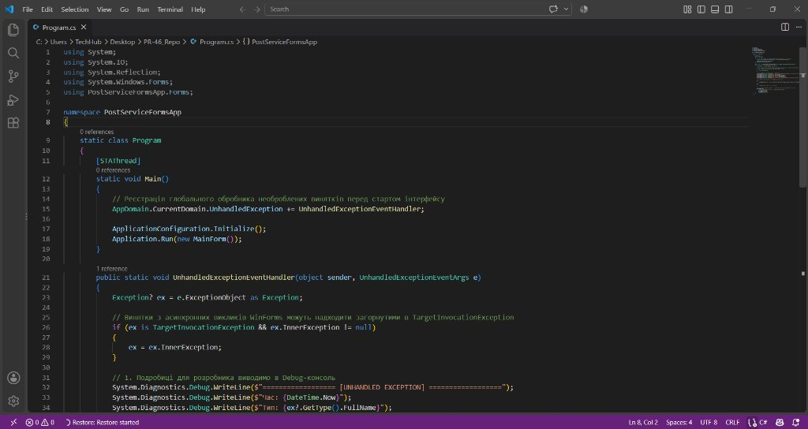
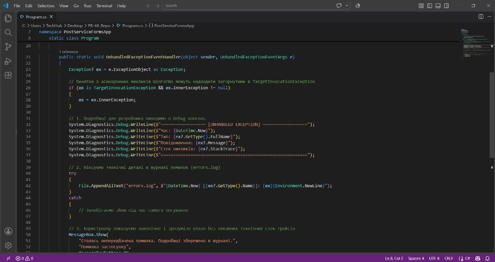
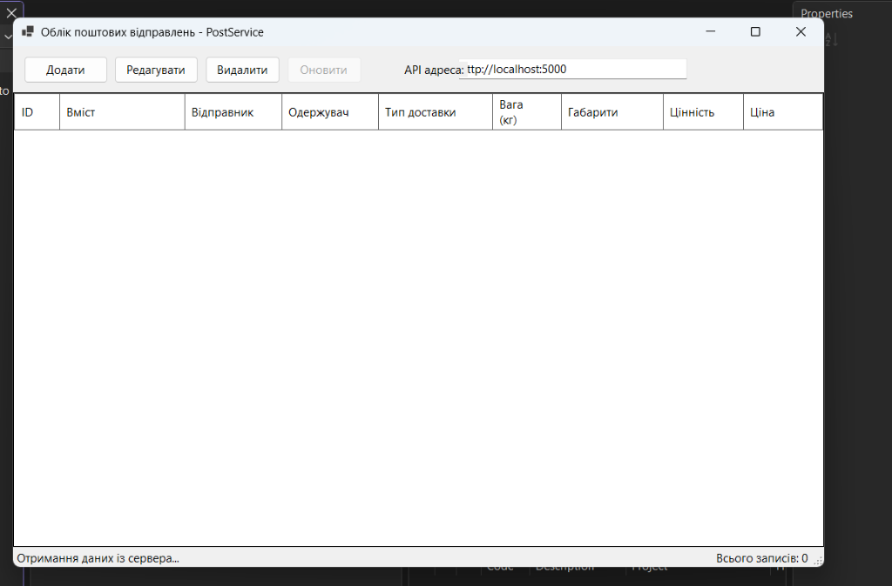
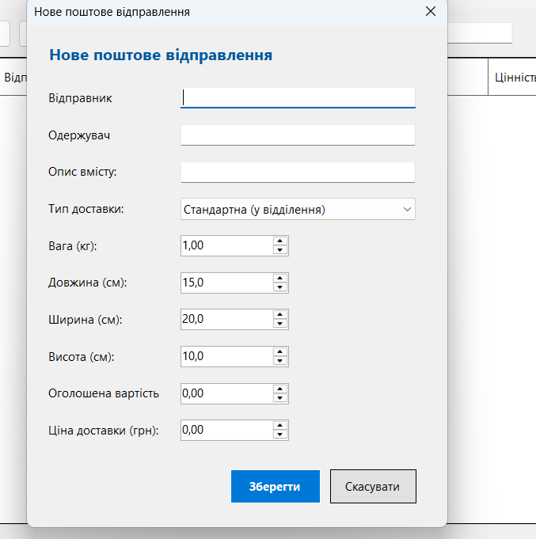

# ПР-46. Робота з обробленими та необробленими винятками

**Тема:** Обробка виняткових ситуацій у клієнтському застосунку Windows Forms при взаємодії з REST API  
**Мета:** Навчитися проєктувати багаторівневу систему обробки винятків у C# Windows Forms; опанувати централізовану обробку мережевих помилок (`HttpRequestException`) та помилок валідації (`PostingValidationException`) у класі `PostServiceClient`; налаштувати реєстрацію глобального обробника непередбачених помилок `AppDomain.CurrentDomain.UnhandledException` із збереженням діагностичних даних у файл `errors.log`.

---

## Хід роботи

### Крок 1. Реєстрація глобального обробника винятків
У файлі `Program.cs` перед ініціалізацією графічної підсистеми та запуском головної форми `Application.Run(new MainForm())` налаштовано перехоплення необроблених винятків процесу через подію:
```csharp
AppDomain.CurrentDomain.UnhandledException += UnhandledExceptionEventHandler;
```
Це гарантує, що будь-яка непередбачена аварійна ситуація у фонових або робочих потоках буде зафіксована до аварійного закриття застосунку операційною системою.



---

### Крок 2. Реалізація методу UnhandledExceptionEventHandler
У методі обробника виконано аналіз отриманого винятку `e.ExceptionObject as Exception`. Якщо виняток виник усередині механізму асинхронних викликів WinForms, він розгортається з обгортки `TargetInvocationException`:
* **Вивід у консоль розробника:** детальні відомості (час, тип винятку, текст повідомлення, повний стек викликів `StackTrace`) записуються через `System.Diagnostics.Debug.WriteLine`.
* **Логування у файл:** за допомогою `File.AppendAllText("errors.log", ...)` технічна інформація дописується у файл журналу помилок.
* **Сповіщення користувача:** замість раптового зникнення вікна застосунку користувачеві виводиться інформативне діалогове вікно `MessageBox.Show("Сталась непередбачена помилка. Подробиці збережено в журналі.", "Помилка застосунку", MessageBoxButtons.OK, MessageBoxIcon.Error)`.



---

### Крок 3. Запуск та тестування головного вікна PostService
Виконано запуск клієнтського застосунку `PostServiceFormsApp`. На головній формі відображається таблиця поштових відправлень із колонками (ID, Вміст, Відправник, Одержувач, Тип доставки, Вага, Габарити, Цінність, Ціна), поле налаштування адреси REST API (`http://localhost:5000`) та панель керування з кнопками «Додати», «Редагувати», «Видалити», «Оновити». Усі операції взаємодіють із типізованим клієнтом `PostServiceClient`.



---

### Крок 4. Діалогове вікно створення та редагування відправлення
При натисканні кнопки «Додати» відкривається модальна форма `PostingEditForm` («Нове поштове відправлення»). Форма містить поля введення обов'язкових та числових реквізитів відправлення з попередньо встановленими значеннями за замовчуванням (вага 1.00 кг, габарити 15x20x10 см). При спробі відправити незаповнені поля сервер повертає статус-код 400 Bad Request, який клієнт перехоплює як `PostingValidationException` та виділяє некоректні поля.



---

## Відповіді на контрольні запитання

### 1. Які групи помилок можуть виникнути під час виклику сервера та чим вони відрізняються за способом прояву в коді клієнта?
* **Недоступність сервера або мережі:** сервер вимкнений чи немає зв'язку. У коді клієнта це виняток `HttpRequestException`, у якого властивість `StatusCode == null`.
* **Помилки введених даних користувача (код 400 Bad Request):** не заповнені обов'язкові поля чи введено некоректні значення. Сервер повертає код 400 і тіло з помилками, яке клієнт перетворює на власний виняток `PostingValidationException`.
* **Помилки застарілих даних (код 404 Not Found):** спроба змінити або видалити запис, який інший користувач уже видалив. Проявляється як `HttpRequestException` зі `StatusCode == 404`.
* **Збої та помилки логіки сервера (код 500 або помилки десеріалізації JSON):** внутрішні аварії на бекенді або несподіваний формат відповіді. Проявляються як `HttpRequestException` з кодом 500 або `JsonException`.

### 2. Чому не можна однаково реагувати на недоступність сервера, помилку валідації та код 500?
Тому що кожна помилка вимагає зовсім різної реакції від користувача:
* Якщо сервер недоступний — логічно запропонувати кнопку «Повторити спробу»;
* Якщо помилка валідації (код 400) — треба показати конкретний перелік помилок і залишити форму відкритою, щоб користувач виправив свої дані;
* Якщо помилка 500 — користувач сам нічого виправити не зможе, тому треба зберегти стек помилки в лог-файл для розробника і спокійно сповістити користувача.

### 3. Чому перехоплювати слід лише ті винятки, для яких відома реакція? Що станеться з рештою винятків?
Якщо перехоплювати всі винятки підряд через `catch (Exception)`, програма просто «проковтне» непередбачені збої, сховає реальну проблему і залишиться в завислому стані. Решта винятків, які ми не чіпаємо у формах, безпечно піднімаються вище і потрапляють у глобальний обробник, який запише подробиці у журнал.

### 4. Яку проблему вирішує виокремлення PostServiceClient порівняно зі створенням HttpClient у кожній формі?
* Адреса сервера (`BaseAddress`) і таймаути налаштовуються в одному місці, а не копіюються по різних формах;
* Логіка перевірки відповідей і статус-кодів (`EnsureSuccessAsync`) централізована і не дублюється;
* Форми працюють безпосередньо зі зручними об'єктами C# і не прив'язані до тонкощів протоколу HTTP.

### 5. Чим відрізняється поведінка GetFromJsonAsync від GetAsync у разі неуспішного статус-коду?
Метод `GetFromJsonAsync` при неуспішному коді відразу викидає стандартний `HttpRequestException`, не дозволяючи нам дістатися до тіла відповіді з описом помилок. Метод `GetAsync` повертає повну відповідь `HttpResponseMessage`, що дає змогу прочитати JSON із помилками валідації при коді 400.

### 6. Чому для помилок валідації створено власний виняток PostingValidationException, а для решти неуспішних кодів достатньо HttpRequestException?
У стандартному винятку `HttpRequestException` є лише числовий код статусу, і в ньому немає поля для зберігання списку помилок за назвами полів. Наш `PostingValidationException` містить словник `Errors`, з якого форма легко дістає всі зауваження для показу користувачеві.

### 7. Чому порожній catch або catch (Exception) без повторного генерування винятку в формі небезпечні?
Тому що вони маскують помилку. Для користувача це виглядає так: кнопку натиснуто, нічого не відбулося, форма не реагує, а чому — невідомо. До того ж, якщо перед запитом кнопки блокувалися, без блоку `finally` вони назавжди залишаться неактивними.

### 8. Що відбувається з програмою після виклику глобального обробника UnhandledException і навіщо він тоді потрібен?
Після завершення глобального обробника операційна система все одно завершує роботу програми. Проте цей обробник потрібен, щоб встигнути записати детальний стек викликів і час збою у файл `errors.log` (для розробника) і показати користувачеві зрозуміле вікно замість аварійного вікна операційної системи.

---

## Висновок
Під час виконання практичної роботи № 46 було закріплено практичні навички обробки виняткових ситуацій у клієнтському Windows Forms застосунку. Всю мережеву взаємодію із сервером винесено в окремий клас `PostServiceClient`, де реалізовано централізований метод `EnsureSuccessAsync` для опрацювання статус-кодів. Для обробки помилок валідації (код 400) створено власний тип винятку `PostingValidationException`, що дозволяє передавати перелік порушених правил безпосередньо у форму. У формах застосунку налаштовано диференційовану реакцію на очікувані помилки за допомогою фільтрів `when` (пропозиція повторити запит при відсутності зв'язку, оновлення списку при 404, збереження відкритої форми для виправлення даних при 400). Для непередбачених помилок реалізовано глобальний обробник `AppDomain.CurrentDomain.UnhandledException`, який запобігає «мовчазному» падінню застосунку, сповіщає користувача та зберігає технічні відомості у файл журналу `errors.log`.
